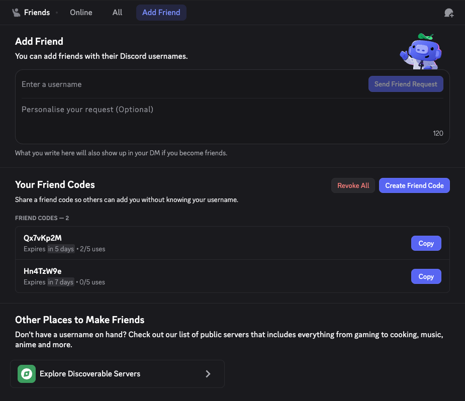

<h1>FriendCodes</h1>

Generate FriendCodes to easily add friends

> [!IMPORTANT]  
> To add custom plugins, you need to build Vencord from source. Follow [this Guide](https://docs.vencord.dev/installing/) if you haven't done this yet

## Installing
If you don't know how to install custom Plugins, follow [this Guide](https://docs.vencord.dev/installing/custom-plugins/)

## Features
- A "Your Friend Codes" panel on the Add Friend page to create, copy and revoke your friend codes
- `/create-friend-code` creates a friend code. Set `ephemeral` to `False` to post it in the chat
- `/revoke-all-friend-codes` revokes all your friend codes

## Preview

